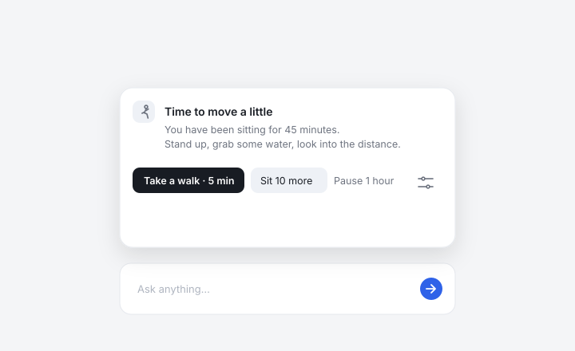

**怎么用**

- 输入框下方的小胶囊会显示当前的久坐时长，点它就能打开设置。
- 连续坐满 45 分钟（可选 30 / 45 / 60 / 90 分钟），底部会滑出一张卡片，给你三个选择：去走走、再坐 10 分钟、暂停 1 小时。
- 休息时有柔和的倒计时，站起来这件事就变成一个明确的决定，而不是凭感觉。
- 只有页面可见、且你真的在操作时才计时；连续 5 分钟没有输入会自动清零，空着的桌子不会被提醒打扰。
- 休息倒计时按真实时间走：切到别的应用、甚至刷新页面，它都接着走，回来刚好结束。
- 设置保存在本地，没有声音、不发系统通知，也不联网。

**设置项**

| 选项 | 可选值 |
| --- | --- |
| 提醒间隔 | 30 / 45 / 60 / 90 分钟（默认 45） |
| 休息时长 | 3 / 5 / 10 分钟（默认 5） |
| 提醒开关 | 开 / 关 |

按 `Esc` 可收起卡片（收起提醒卡片等于"再坐 10 分钟"）；在设置里把开关关掉，就完全安静了。
